# Advanced Weather

A weather mod for Minecraft 1.21.1 (NeoForge). It replaces vanilla's clear, rain and thunder with 28 weather types across the Overworld, the Nether and the End, driven by a simulated atmosphere, and adds instruments you build to measure and forecast it.

[]()
[]()
[](LICENSE.txt)

[Modrinth](https://modrinth.com/mod/advanced-weather) · [CurseForge](https://www.curseforge.com/minecraft/mc-mods/advanced-weather) · [Issues](https://github.com/Antop90fr1/AdvancedWeather1.21.1/issues)

<p align="center">
  
</p>

---

## How it works

Each dimension has its own atmosphere: air pressure, temperature, dew point, humidity and wind, updated every tick and saved with the world. The next weather is drawn from a transition graph whose odds follow that air, so a falling barometer really does mean worse weather is likely. Changes are gradual: the sky, fog, clouds, particles and sounds blend from one weather to the next.

Temperature depends on the weather, the time of day, the biome and the height you stand at. Seasons count too if Serene Seasons or Ecliptic Seasons is installed.

You can leave it running on its own, follow the real weather of any place on Earth (opt-in), or set it by command.

---

## Weather types

**Overworld (17):** Clear, Sunny, Cloudy, Overcast, Mist, Fog, Dense Fog, Drizzle, Light Rain, Heavy Rain, Freezing Rain, Thunderstorm, Snow, Blizzard, Hail, Windy, Sandstorm

**Nether (6):** Nether Clear, Ash Storm, Brimstone Storm, Lava Rain, Netherstorm, Hellfire

**The End (5):** End Clear, End Mist, Void Storm, Chorus Gale, Enderstorm

Our weather decides what falls everywhere: if it snows, it snows in every biome, deserts included. What stays on the ground still depends on how warm the place is.

<table>
  <tr>
    <td width="50%">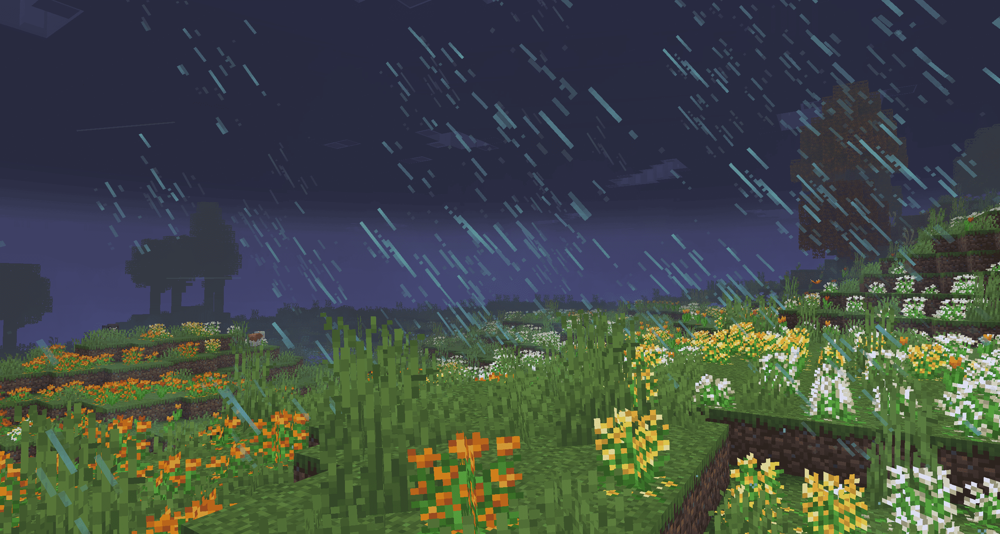<br><sub>Thunderstorm at night, rain slanted by the wind</sub></td>
    <td width="50%">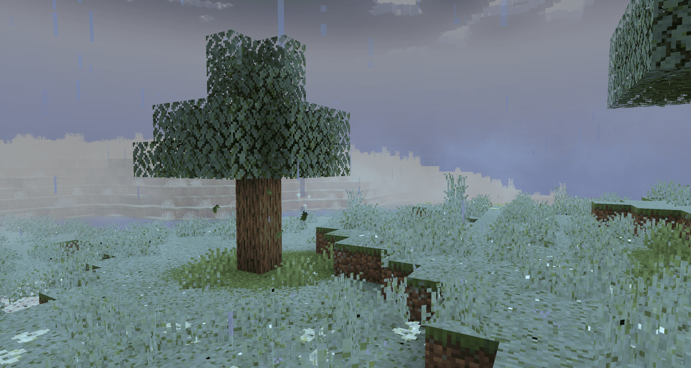<br><sub>Freezing rain glazing the ground and the grass</sub></td>
  </tr>
  <tr>
    <td width="50%">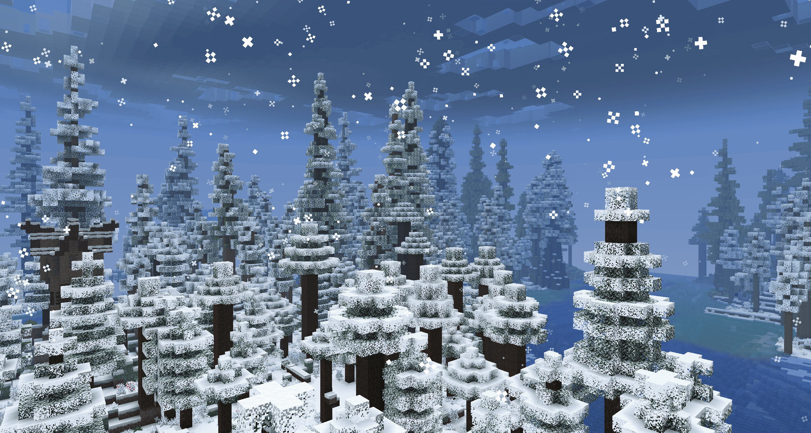<br><sub>Snow settling on a taiga</sub></td>
    <td width="50%">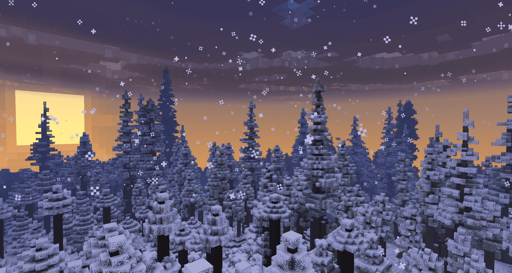<br><sub>The same forest at sunrise</sub></td>
  </tr>
  <tr>
    <td width="50%">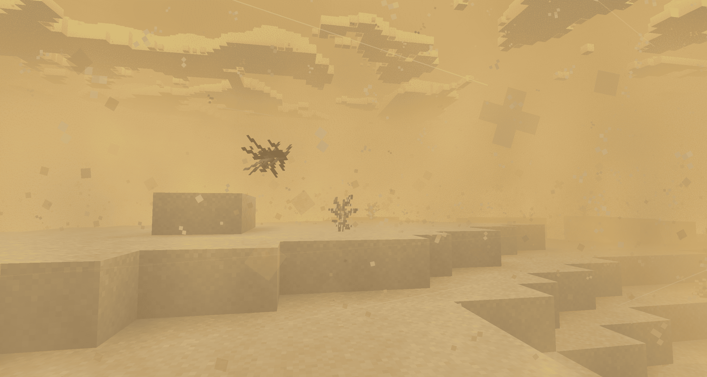<br><sub>Sandstorm in a desert, with tumbleweeds</sub></td>
    <td width="50%">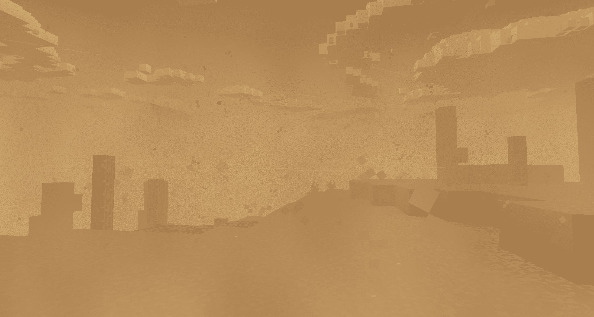<br><sub>Red sand in the badlands</sub></td>
  </tr>
  <tr>
    <td width="50%">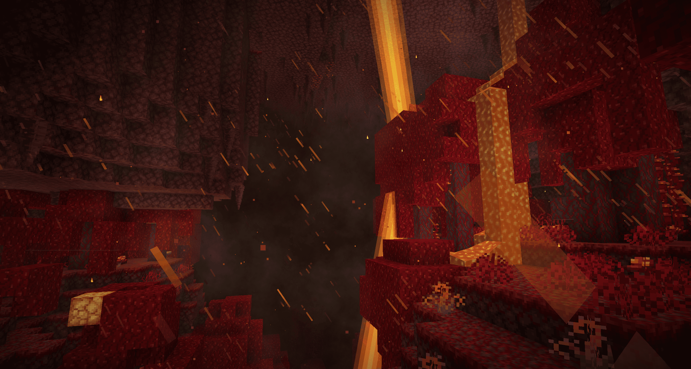<br><sub>Netherstorm: lava rain, embers and lightning</sub></td>
    <td width="50%">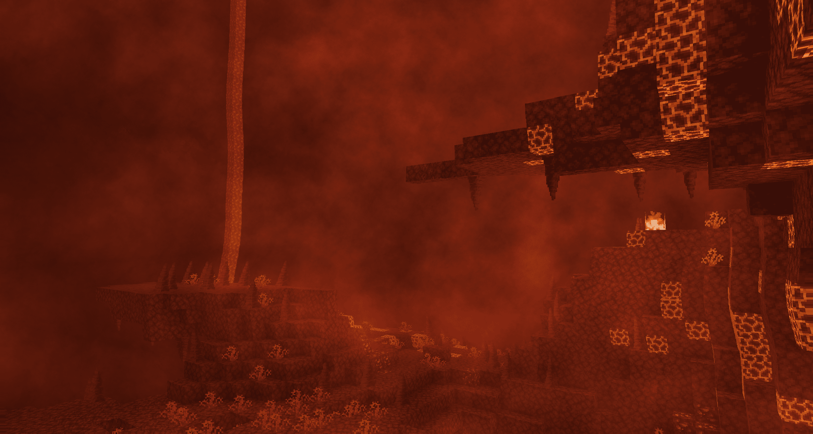<br><sub>Hellfire, the hottest weather in the mod</sub></td>
  </tr>
  <tr>
    <td width="50%">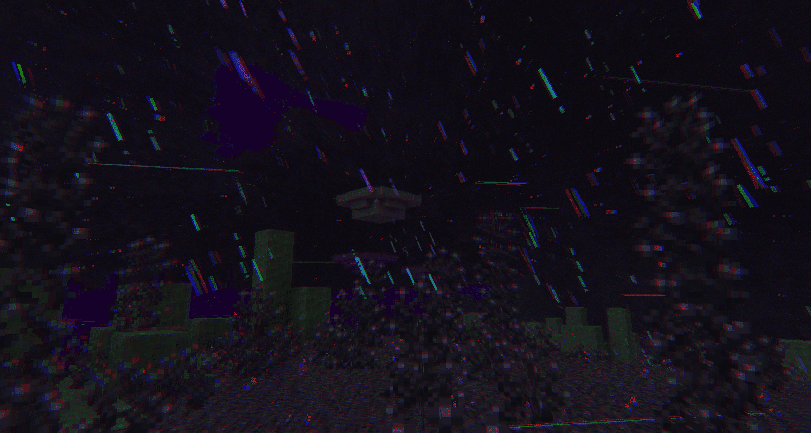<br><sub>Enderstorm: void rain and a distorted view</sub></td>
    <td width="50%">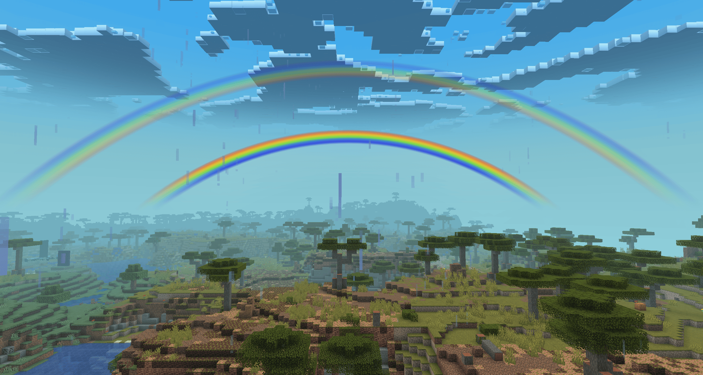<br><sub>A double rainbow after the rain</sub></td>
  </tr>
</table>

---

## Sky, wind and ground

**Clouds.** A new cloud renderer: clouds build up, darken and cover the sky with the weather, drift with the wind and catch the light of the sun.

<table>
  <tr>
    <td width="50%">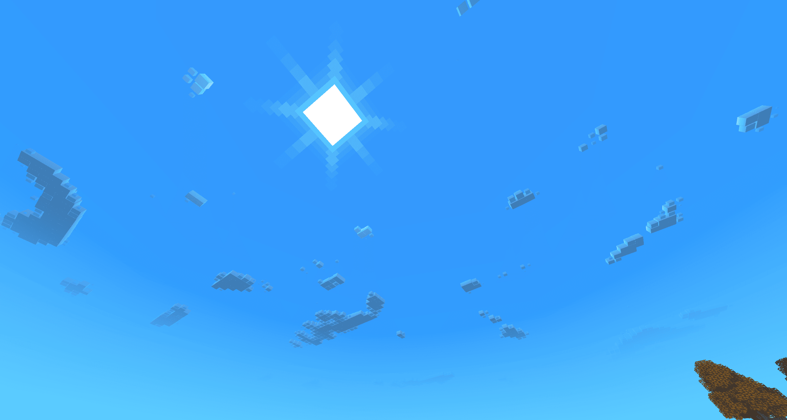<br><sub>A clear day</sub></td>
    <td width="50%">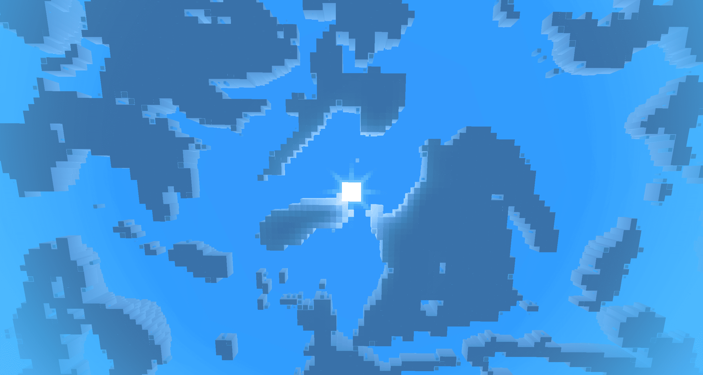<br><sub>A cloudy one</sub></td>
  </tr>
</table>

**Storms you see coming.** A minute or more before some weathers arrive, you can see them upwind: a thunderstorm flashes on the horizon and its thunder gets closer, a sandstorm shows as a wall of dust, and the clouds turn yellow before hail. The Netherstorm and the Enderstorm announce themselves the same way.

**Wind.** The wind has a direction that slowly turns, gusts that travel across the land, and a speed shown in km/h or mph with its Beaufort name. It pushes particles, bends grass, flowers, crops and leaves, draws wind lines in strong weather, plays its own sounds, spreads fire downwind, turns Create windmills faster (visual only) and pushes Create: Aeronautics contraptions.

**Ground cover.**
- **Snow** lies on everything open to the sky and melts as the air warms up. Snow layers follow the same amount.
- **Freezing rain** glazes the ground with ice, and the ground gets slippery. Snow under that crust lasts longer.
- **Sandstorms** leave sand on the ground in sandy biomes. The wind blows it away and the rain washes it off.

**Effects.** Each weather has its own fog and sky colour per biome, particles and overlays: blizzard flakes, sand, ash, brimstone, hail, lava and void rain, ground mist, rainbows in the morning and evening light, heat shimmer in Hellfire, a chromatic distortion in the Enderstorm, tumbleweeds and chorus petals carried by the wind, and ripples on water and lava.

**Kite.** Craft a kite, dye each of its panels, and fly it. It follows the wind, and in strong wind it pulls you along and breaks your falls. In a thunderstorm, lightning can strike it.

<p align="center">
  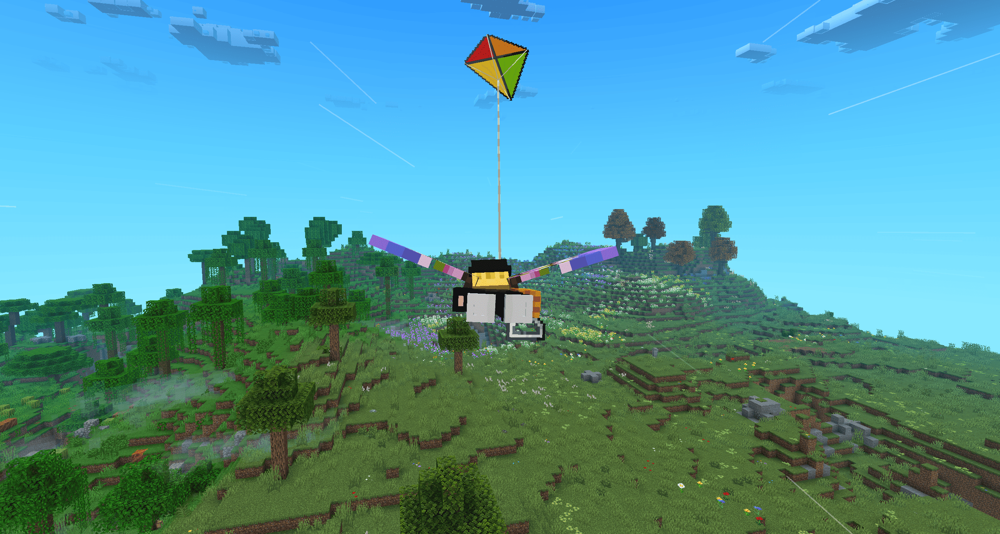
</p>

---

## Gameplay

Every effect below can be turned off in the config.

- **Crops:** drizzle and light rain make crops and saplings grow faster, sunny days a little too. Heavy rain slows them, hail damages them, and a long blizzard or freezing rain kills exposed crops. Long hot dry spells dry out farmland.
- **Hail** hurts anything outside, animals included, and breaks glass. Mobs look for shelter from hail, blizzards, sandstorms and thunderstorms.
- **Sandstorms** slow down and tire players out in the open.
- **Fog** lets players get closer to monsters before being spotted. In dense fog, monsters can spawn even in daylight, never near a light.
- **Rainbows** give Luck to players under the sky.
- **Lava Rain** sets fire to mobs and players under the sky. A netherite helmet protects you.
- **Void Storm** surges lift the air above the void: they carry an elytra and slow a fall.
- **Wind** spreads fire one block downwind.

---

## Instruments and progression

You have to build the tools before you can read the weather.

- **Materials:** Cinnabar ore is washed and distilled into Mercury. Bauxite is refined into Alumina, then reduced into Aluminum (ingots, nuggets and sheets). The Hammer crushes and presses by hand, and Create's crushing wheels work too.
- **Calibration:** each instrument needs a calibrated part (a spring, a cup rotor, a sensitive fiber, or a mercury vial). You calibrate springs, rotors and fibers at the Calibration Bench through a small mini-game.
- **Portable instruments:** Thermometer (with a "feels like" temperature), Barometer (with the pressure trend), Hygrometer and Anemometer. Use them to read the air where you stand.

<table>
  <tr>
    <td width="50%">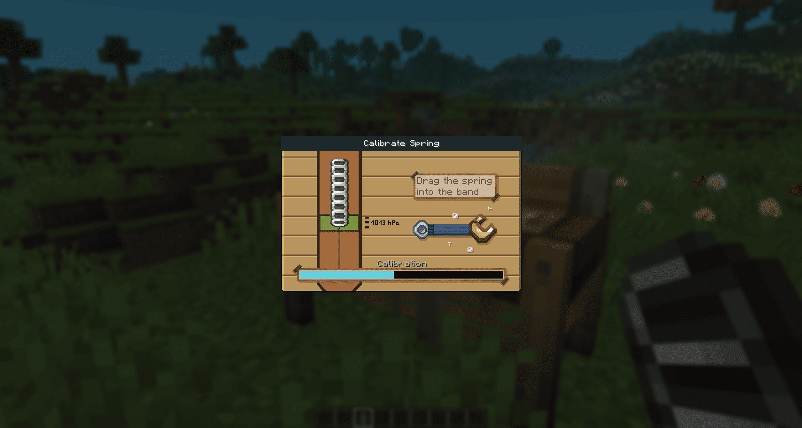<br><sub>Calibrating a spring at the Calibration Bench</sub></td>
    <td width="50%">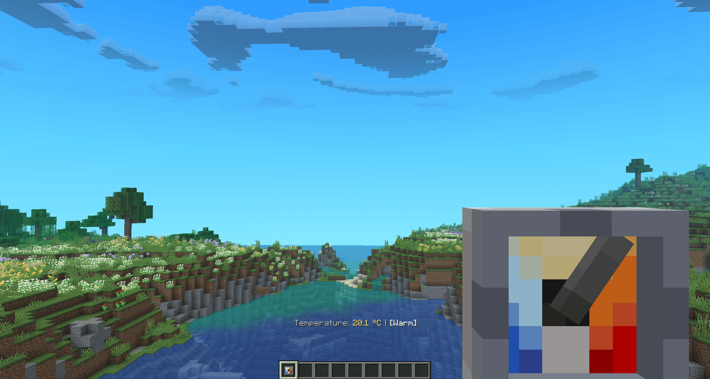<br><sub>A reading from the portable thermometer</sub></td>
  </tr>
</table>

**Weather station network:**
- **Sensors** (thermometer, barometer, hygrometer, anemometer) have placement rules: a thermometer must be shaded but get airflow, an anemometer needs open sky. A badly placed sensor gives bad readings.
- The **Weather Station** shows the readings of the sensors linked to it with the Calibration Tool. Right-click it with paper to print a **Weather Report**.
- The **Weather Archive** keeps reports and almanacs, draws graphs of their history and forecasts the next weather, with a confidence level.
- The **Auto-Sampler** sends the station's readings to an archive at a set interval.
- The **Weather Detector** gives a redstone signal for rain, snow, any precipitation, storms, thunderstorms or hail, or an analog signal for wind speed. With early warning on, it turns on 90 seconds before the weather arrives.
- The **Weather Almanac** is a portable book of archived reports.
- With Create, a Display Link reads the Weather Station and shows its readings on Display Boards.

<table>
  <tr>
    <td width="50%">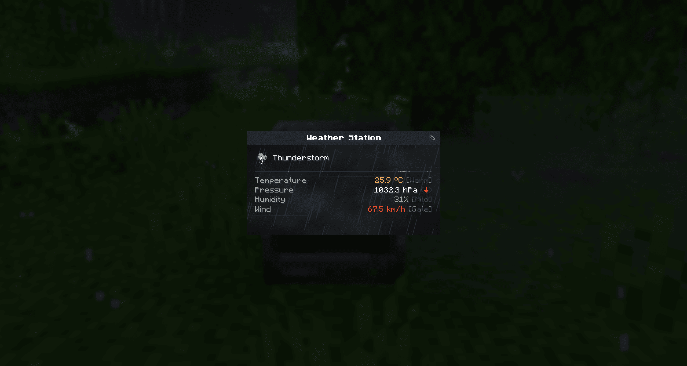<br><sub>The Weather Station during a thunderstorm</sub></td>
    <td width="50%"><br><sub>Station, archive and detector</sub></td>
  </tr>
</table>

**Changing the weather:** use a mercury vial on a Block of Aluminum and it slowly grows a Dormant Crystal (faster in humid air). Drop that crystal where the right weather can reach it (struck by lightning in a thunderstorm, in lava during Hellfire, into the void during an Enderstorm, at the height limit under a clear sky) to charge it. Charged crystals make Seeding Rockets: rain, clear, frost or warm. Fire one to nudge the air towards that weather for a couple of minutes.

A configurable **HUD** shows the current weather and the time of day.

An **advancement tab** follows your progress, from your first reading to every weather of every dimension.

---

## Real-world weather (opt-in)

Turn it on in the config, set a latitude and longitude (or pick a place with `/aw map`), and the Overworld follows the live weather of that place, from Open-Meteo. The place name comes from OpenStreetMap Nominatim.

> This mode is off by default. When it is on, the coordinates you set are sent to Open-Meteo and Nominatim. Nothing leaves your game otherwise.

---

## Compatibility

| Mod                                 | Type              | What it does with Advanced Weather                                               |
|-------------------------------------|-------------------|----------------------------------------------------------------------------------|
| **YetAnotherConfigLib (YACL)**      | Required (both)   | Config files and the in-game config screen                                       |
| **Create**                          | Optional          | Windmill sails follow the wind (visual only); weather on Display Boards          |
| **Create: Aeronautics / Simulated** | Optional          | The wind pushes flying contraptions                                              |
| **Serene Seasons**                  | Optional          | Seasons shape the weather, temperature and dew point                             |
| **Ecliptic Seasons**                | Optional          | Its solar terms shape the weather, temperature and dew point; we drive its rain  |
| **Cold Sweat**                      | Optional          | Weather, wind and humidity change your body temperature                          |
| **JEI**                             | Optional (client) | Calibration and amalgamation recipes, kite dyeing                                |
| **Particle Rain**                   | Optional (client) | Its rain, snow and dust follow our weather and wind; lava and void rain use its drops |
| **ATMOSPHERICS**                    | Optional (client) | Its biome fog, sky and dust stay; our weather fog, clouds and wind take the lead |
| **Iris Shaders**                    | Partial           | With a shader pack on, our clouds, fog and ground cover give way to the pack     |

<p align="center">
  
</p>

The mod is translated into English and French.

---

## Requirements

- **Minecraft** 1.21.1
- **NeoForge** 21.1.233+
- **YetAnotherConfigLib** 3.6+, on the client and the server

---

## Configuration

Two config files in `config/`: `advancedweather-common.json` (weather, gameplay, real weather, archive, compat) and the client one (HUD, units, clouds, wind, particles, ground cover). Both can be edited in game from the mod list, through YACL.

- **Weather types:** turn any weather on or off, or a whole dimension.
- **Gameplay:** each effect listed above has its own switch.
- **Instruments:** whether stations need sensors, and how far a sensor can be from its station.
- **Archive:** capacity, records needed for a forecast, confidence, how fast data gets old.
- **Real weather:** on/off, coordinates, sync interval, whether it overrides commands.
- **Client:** °C or °F, km/h or mph, HUD position, cloud distance, wind lines, foliage sway, snow and sand cover, particle amounts.

---

## Commands

All commands start with `/aw`. Server commands need permission level 2 (operator). The client commands need none.

| Command | Description |
|---|---|
| `/aw` | Show the current weather |
| `/aw history` | Recent weather history |
| `/aw set <type>` | Switch to a weather now; it lasts a normal spell, then the weather engine carries on |
| `/aw approach <type>` | Bring a thunderstorm, sandstorm, hail, Netherstorm or Enderstorm, seen coming first |
| `/aw auto` | Start a new natural spell and redraw the next weather |
| `/aw force <pressure> <dewpoint> <temp> <seconds> [bias]` | Push the atmosphere for a while |
| `/aw seed <pressure> <dewpoint> <temp> <seconds> <bias>` | Same, and bring the change within about 25 seconds |
| `/aw force clear` | Remove the active pushes |
| `/aw rainbow spawn\|clear` | Show or remove a rainbow |
| `/aw effect add\|remove <effect>` | Turn a single visual effect on or off |
| `/aw refresh` | Fetch the real weather now (real weather must be on) |
| `/aw setlocation <lat> <lon>` | Set the real-weather coordinates |
| `/aw debug` | Toggle the debug overlay |
| `/aw map` | Client: pick the real-weather place on a map |
| `/aw reset` | Client: clear the weather data cached by your game |

---

## For developers

Advanced Weather has a small public API under `net.antopfr.advancedweather.api`. It is a set of static methods: there is nothing to register or to create. Everything **outside** that package is internal and may change without notice, apart from the `WeatherTypes` and `AtmosphericForcing.Bias` enums, which the API uses.

**Setting up** - compile against the mod's jar and declare it as an optional dependency:

```groovy
dependencies {
    compileOnly files("libs/advancedweather-0.1.3.jar")
}
```

```toml
[[dependencies.yourmod]]
modId = "advancedweather"
type = "optional"
versionRange = "[0.1.3,)"
ordering = "NONE"
side = "BOTH"
```

Keep your calls in a class of your own, and only touch it when the mod is there:

```java
if (ModList.get().isLoaded("advancedweather")) {
    MyWeatherCompat.init();
}
```

**Server side** - `AdvancedWeatherAPI`, on the server thread, with any `ServerLevel`:

```java
// The weather, and what comes next
WeatherTypes now = AdvancedWeatherAPI.getCurrentWeather(level);
WeatherTypes coming = AdvancedWeatherAPI.getComingWeather(level);   // certain, but null until about 90 s before the change
int left = AdvancedWeatherAPI.getTicksUntilNextWeather(level);      // -1 where real weather drives the level
WeatherForecast forecast = AdvancedWeatherAPI.getForecast(level);   // an estimate: next and in 30 minutes, with confidence

// The air: for the whole level, or at a place with its biome and height
AtmosphereSnapshot air = AdvancedWeatherAPI.getAtmosphere(level);
float temperature = AdvancedWeatherAPI.getLocalTemperature(level, pos);
float wind = AdvancedWeatherAPI.getWindSpeedKmh(level, pos.getCenter());

// What lies on the ground, from 0 to 1
float snow = AdvancedWeatherAPI.getSnowCover(level, pos);
float sand = AdvancedWeatherAPI.getSandCover(level, pos);

// Changing the weather
AdvancedWeatherAPI.setWeather(level, WeatherTypes.THUNDERSTORM);       // at once; false if wrong dimension
AdvancedWeatherAPI.approachWeather(level, WeatherTypes.THUNDERSTORM);  // seen coming first, arrives in 90 s

// Nudging the atmosphere: pressure, dew point and temperature, for one minute here
AdvancedWeatherAPI.applyForcing(level, -30f, 8f, 0f, 20 * 60);         // weighs on the next change
AdvancedWeatherAPI.seedWeather(level, -30f, 8f, 0f, 20 * 60, AtmosphericForcing.Bias.SEEDING); // and brings it within 25 s

AdvancedWeatherAPI.startAutoWeather(level);                            // new natural duration, next weather redrawn
```

A weather set this way is not pinned: it lasts one natural spell, then the engine carries on. Where the Overworld follows real weather, the next sync replaces it. The atmosphere only decides the weather in the Overworld: in the Nether and the End, a forcing moves the readings, not the odds.

**Listening for changes** - `WeatherChangeEvent` on the NeoForge bus, on the server, whatever caused the change:

```java
NeoForge.EVENT_BUS.addListener((WeatherChangeEvent e) -> {
    if (e.getCurrent() == WeatherTypes.BLIZZARD) { /* ... */ }
});
```

**Client side** - `AdvancedWeatherClientAPI`, for HUD add-ons, on the client thread only. It reads what the local player sees:

```java
WeatherTypes shown = AdvancedWeatherClientAPI.getCurrentWeather();
float felt = AdvancedWeatherClientAPI.getTemperature();
float kmh = AdvancedWeatherClientAPI.getLocalWindSpeedKmh();
WeatherTypes storm = AdvancedWeatherClientAPI.getComingWeather();      // only the storms seen coming in the sky
float cover = AdvancedWeatherClientAPI.getSnowCover();
```

Registering **custom weather types** from another mod is not supported yet - planned for a later API revision.

---

## License

Released under the **MIT License**. See [LICENSE](LICENSE.txt).

## Third-party software notices

This software embeds the following third-party libraries via JarJar:

1. **[Registrate](https://github.com/tterrag1098/Registrate)**
    - Authors: tterrag, Create Mod Team
    - License: [MPL-2.0 License](licenses/REGISTRATE-LICENSE.txt)

2. **[Veil](https://github.com/FoundryMC/Veil)**
    - Authors: Foundry Systems
    - License: [GNU Lesser General Public License v3.0 (LGPL-3.0)](licenses/VEIL-LICENSE.txt)

The respective licenses and copyright notices for these libraries apply.
See included files for full license texts where applicable.

## Credits

Created by **Antopfr**.

Real-world weather data © [Open-Meteo](https://open-meteo.com/). Location names © [OpenStreetMap contributors](https://www.openstreetmap.org/copyright) via Nominatim.
