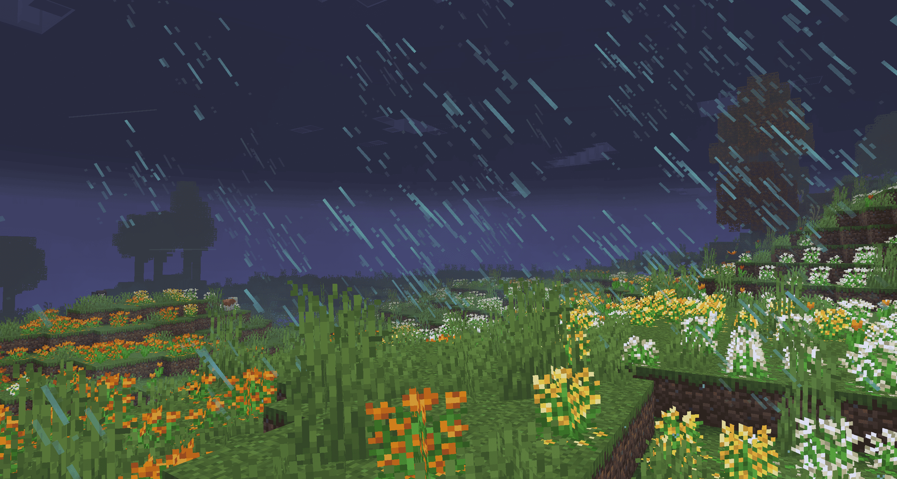
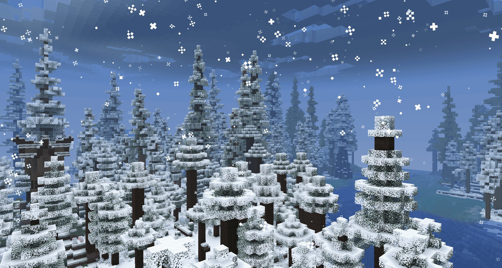
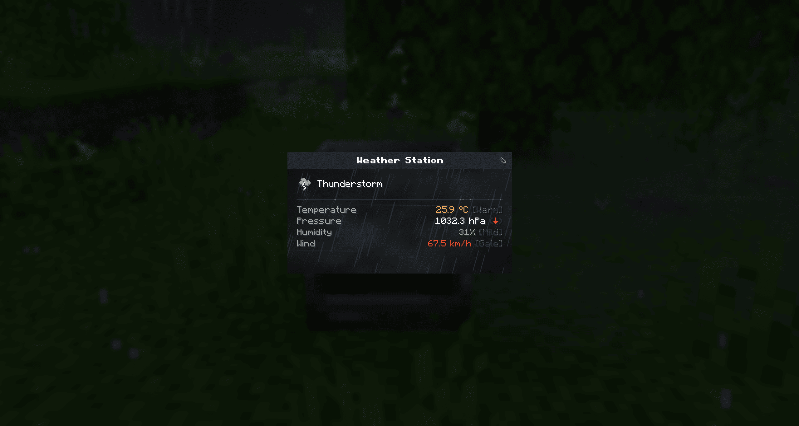

Advanced Weather replaces vanilla's rain and thunder with 28 weather types: 17 in the Overworld, 6 in the Nether and 5 in the End. The weather comes from a simulated atmosphere (pressure, temperature, humidity and wind), so it changes a little at a time, the way real weather does, and you can learn to read it.

## What it adds

- Fog, mist, drizzle, heavy rain, freezing rain, hail, snow, blizzards, sandstorms, thunderstorms and rainbows. The Nether gets ash storms, lava rain and Hellfire, the End gets void storms and Enderstorms.
- New clouds that follow the weather and the wind.
- Storms you can see coming: lightning on the horizon, a wall of dust, clouds turning yellow before hail.
- Wind with a direction and gusts. It bends grass and leaves, pushes particles, spreads fire, and pulls you along if you fly a kite.
- Snow that settles and melts, ice after freezing rain, sand left behind by sandstorms.
- Weather you have to deal with: rain helps crops, hail breaks glass and hurts animals left outside, fog hides you from monsters, lava rain sets you on fire.

## Measuring it

Make thermometers, barometers, hygrometers and anemometers out of mercury, aluminum and parts you calibrate yourself. Link sensors to a weather station, print weather reports, and keep them in an archive that forecasts the next weather. A detector sends a redstone signal before a storm arrives. Seeding rockets let you push the weather the way you want.

## Good to know

- Needs YetAnotherConfigLib on the client and the server, and NeoForge 21.1.233 or newer.
- Works with Create, Create: Aeronautics, Serene Seasons, Ecliptic Seasons, Cold Sweat, Particle Rain, ATMOSPHERICS and JEI.
- With a shader pack on, the pack's clouds and fog replace the mod's, and the snow and sand on the ground don't show.
- Can follow the real weather of any place on Earth. This is off by default.
- Every gameplay effect can be turned off in the config.
- In English and French.

The full feature list, the commands and the API are on [GitHub](https://github.com/Antop90fr1/AdvancedWeather1.21.1).
